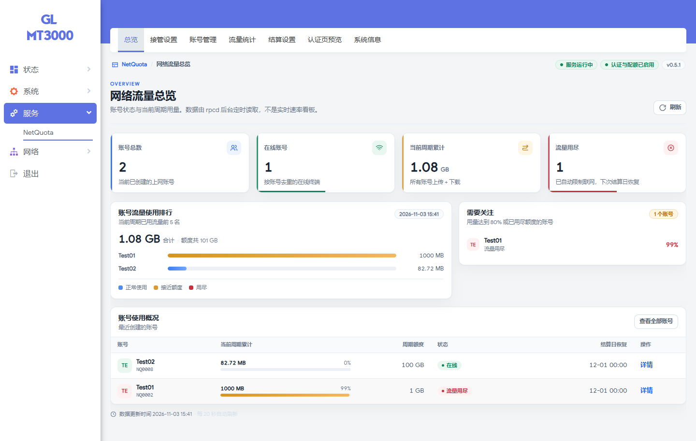
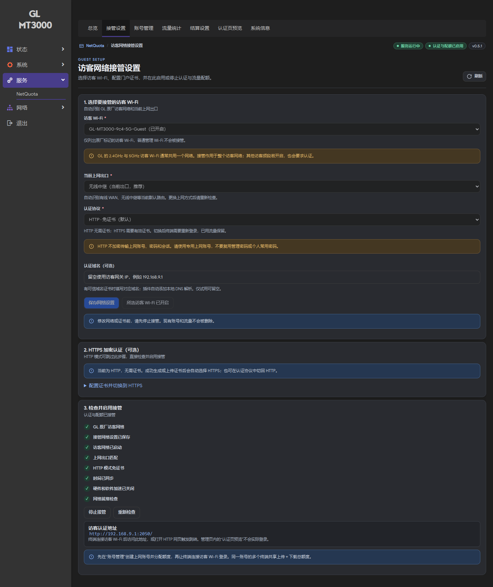
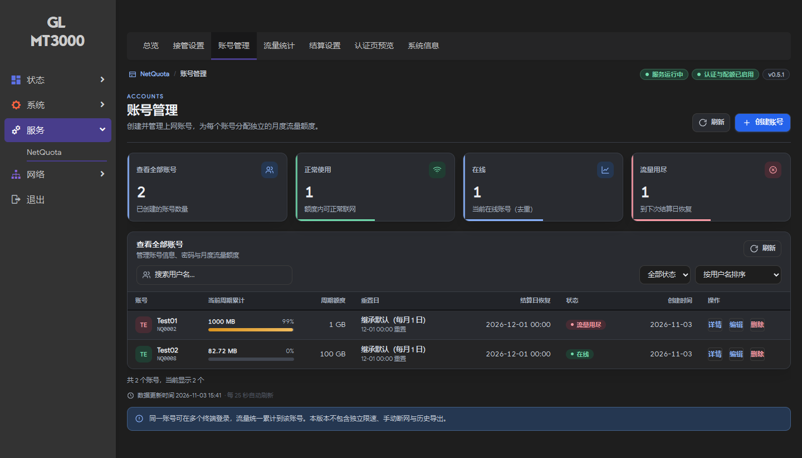
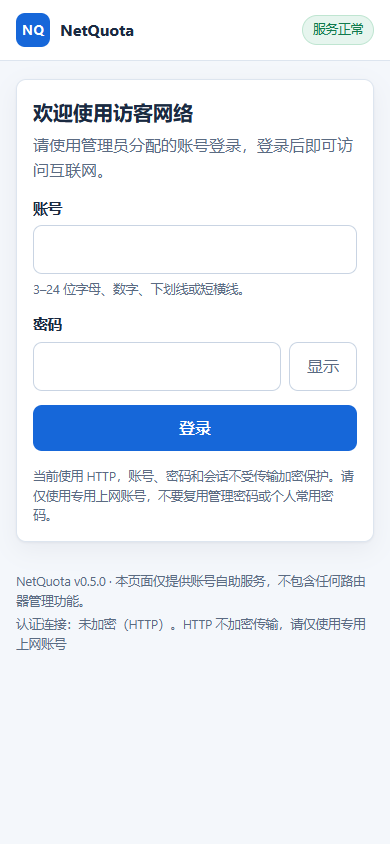
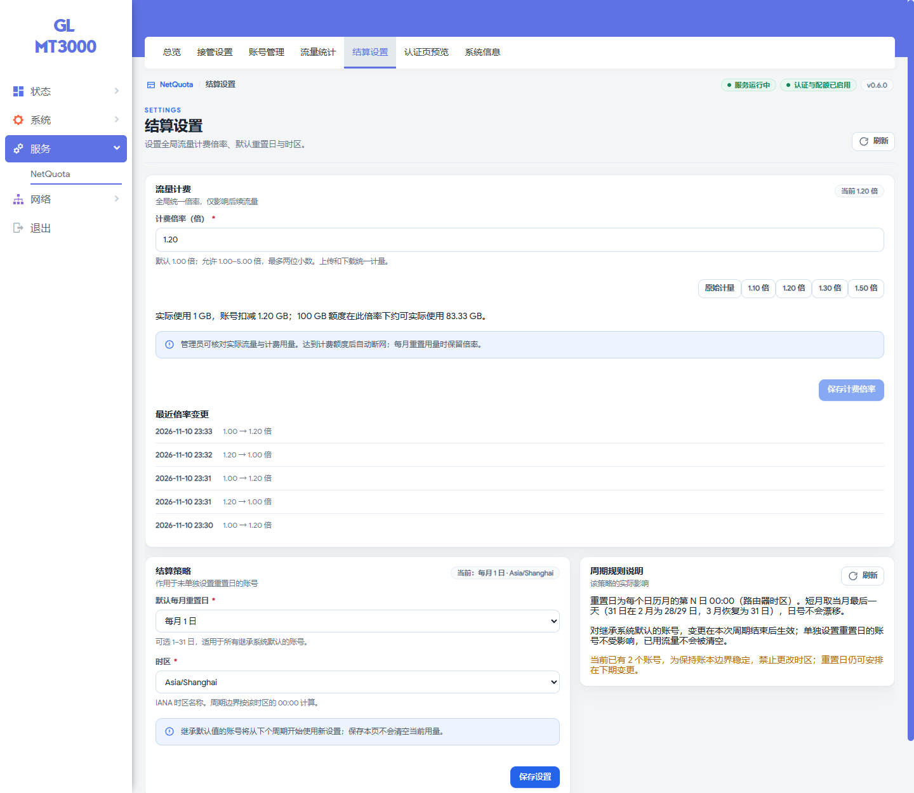

<div align="center">

# NetQuota

**为 GL.iNet / OpenWrt 访客网络提供账号认证与共享月度流量配额**

[](https://github.com/XIAOZHAOXSXH/luci-app-netquota/actions/workflows/build-release.yml)
[](https://github.com/XIAOZHAOXSXH/luci-app-netquota/releases/latest)
[](LICENSE)

[下载软件包](https://github.com/XIAOZHAOXSXH/luci-app-netquota/releases) · [图形化部署指南](docs/DEPLOYMENT.md) · [构建说明](docs/BUILDING.md) · [反馈问题](https://github.com/XIAOZHAOXSXH/luci-app-netquota/issues)

</div>

NetQuota 将路由器自带的访客 Wi-Fi 接入账号认证：访客登录后上网，同一账号的多个终端共享一份月度额度，上传与下载合计计量。额度用尽后阻断外网，下个结算周期恢复；管理员通过 LuCI 完成日常配置，无需客户使用 SSH。

<picture>
  <source media="(prefers-color-scheme: dark)" srcset="docs/screenshots/overview-dark.png">
  
</picture>

> 截图均来自真实 MT3000 运行环境。当前已完成原厂固件下的手机登录上网、计量与配额阻断验证；MT6000 和 APK 固件的运行验证仍待完成。

## 功能

| 功能 | 说明 |
| --- | --- |
| 原厂访客网络接管 | 识别 GL 原厂 Guest Wi-Fi，选择网络及实际出口，图形化启用与停止 |
| 独立上网账号 | 创建、编辑、删除账号，设置月额度与重置日，管理员改密、自助改密 |
| 共享流量额度 | 多终端共用同一账号，上传 + 下载合计扣减，展示当前周期与剩余量 |
| 全局计费倍率 | 在结算设置中选择 1.00–5.00 倍，实际流量与计费用量分别保留，仅影响后续流量 |
| 自动结算 | 按账号重置日进入新周期；日期调整下期生效，保留本期用量 |
| 超额限制 | 额度耗尽后停止外网访问，仍可访问认证页查看用量 |
| HTTP / HTTPS | 默认 HTTP，免域名、免证书；配置证书后自动选择 HTTPS，也可手动切换 |
| 证书管理 | 图形化生成测试证书、导入证书/私钥、校验地址及有效期、下载公共证书 |
| 主题与移动端 | 跟随 LuCI 亮暗主题，访客门户适配手机与系统颜色偏好 |
| 本地持久化 | SQLite 保存账号及账本，procd 管理服务，运行不依赖外部认证平台 |

## 适用设备与固件

| 环境 | 状态 |
| --- | --- |
| GL-MT3000，原厂 GL.iNet 4.11.0 / OpenWrt 21.02-SNAPSHOT，opkg / fw3 | **已实机验证**，包含真实手机 Wi-Fi 接入 |
| GL-MT6000 | 目标设备，仍需按实际固件验证 |
| 使用 apk v3 的 OpenWrt / GL 固件 | 提供 APK 构建及包校验；**尚未完成设备运行验证** |
| 自定义访客拓扑、普通 OpenWrt 无 GL Guest 配置 | 首版不自动接管，不能套用原厂向导 |

软件包为架构无关的 Lua / Shell / JavaScript 与静态资源，IPK 标记 `all`，APK 标记 `noarch`。这表示包中没有 CPU 专用二进制，**不表示所有固件均已兼容**。依赖来自设备自身软件源；不要把其他固件的内核模块或依赖包混装到路由器上。

启用接管前需要：

- 在 GL 原厂界面关闭硬件和软件网络加速，避免流量绕过计量。
- 保持访客网络原有 DHCP、DNS、外网转发与隔离规则可用。
- 保持路由器时间同步；时间不可信时，新认证和自动结算会暂停。

## 安装

从 [Releases](https://github.com/XIAOZHAOXSXH/luci-app-netquota/releases) 下载同一版本的两个包。正式版使用 `v版本号`，主分支构建为带 `build` 的预览版。

| 包管理器 | 后端包 | LuCI 界面包 |
| --- | --- | --- |
| opkg | `netquota_<版本>_all.ipk` | `luci-app-netquota_<版本>_all.ipk` |
| apk v3 | `netquota-<版本>-r1.apk` | `luci-app-netquota-<版本>-r1.apk` |

1. 打开固件的 **LuCI → 系统 → 软件包**，使用上传安装功能。
2. **先安装后端 `netquota`，再安装界面 `luci-app-netquota`**，并让包管理器处理当前固件的软件源依赖。
3. APK 是 OpenWrt 的本地无签名包，需要允许安装未签名软件包；它不是 Android 应用。
4. 刷新 LuCI，进入 **服务 → NetQuota**。若菜单或界面仍为旧版，按 `Ctrl+F5` 强制刷新。

新安装默认关闭接管，认证协议默认 HTTP。升级保留原有配置和账号；早期 HTTPS 版本升级时保留原协议，可在页面中显式切换。

Release 同时提供 `SHA256SUMS` 和 `BUILDINFO.json`，用于校验下载文件和追溯源码提交、构建记录。

## 快速使用

### 1. 配置访客网络

打开 **服务 → NetQuota → 接管设置**，选择原厂 Guest Wi-Fi，保留向导推荐的实际出口。选择 HTTP 时无需填写域名或证书，保存网络设置即可。

GL 的 2.4GHz 与 5GHz Guest 通常共用一个访客网络。接管会作用于整个 Guest 网络；另一个访客频段若开启，也需要认证。



### 2. 创建账号并启用

在 **账号管理** 创建上网账号，填写密码、月额度与重置日。返回 **接管设置**，确认检查项通过后，点击 **启用接管**。页面显示认证与配额已启用后，访客需要登录才能上网。

额度按十进制 GB 计算（1 GB = 1,000,000,000 字节）。修改额度立即生效，修改重置日下期生效；仅修改额度不会清空已有用量。



### 3. 访客登录

连接所选 Guest Wi-Fi，使用路由器原有的 Wi-Fi 密码。系统弹出认证页面后，再使用管理员创建的 **NetQuota 上网账号** 登录；两者是不同凭据。

若系统未弹出认证页，可在访客网络内打开接管设置显示的认证地址。本机默认 HTTP 示例为 `http://192.168.9.1:2050/`，实际地址以页面为准。

<div align="center">
  
</div>

### 4. 可选：设置流量计费倍率

上游计量与路由器统计存在差异时，可在 **NetQuota → 结算设置 → 流量计费** 设置全局倍率。默认 **1.00 倍**；例如设置 **1.20 倍**，实际上传＋下载 1 GB，账号扣减 1.20 GB，100 GB 额度约可实际使用 83.33 GB。

点击 **保存计费倍率 → 确认并生效**。保存时先结清旧倍率下的流量，后续新增流量才使用新倍率；已有扣减、账号额度和重置日保持不变。修改回 1.00 倍也不会返还此前扣减。每月重置用量时保留倍率。

账号列表、总览和剩余额度以**计费用量**为准，账号详情和流量统计同时提供原始实际流量，访客门户注明计量规则。断网由换算后的内核共享配额执行。倍率是人工设置的余量策略，不会自动读取上游账单，也不会计入绕过受控账号的流量。

<picture>
  <source media="(prefers-color-scheme: dark)" srcset="docs/screenshots/billing-settings-dark.png">
  
</picture>

### 5. 可选：开启 HTTPS

需要加密认证时，在接管设置中配置对应域名与证书。成功生成或导入有效证书后，插件自动选择 HTTPS；保存并启用即可。更换网络、协议或证书前先停止接管。切换协议会撤销旧登录，账号与已用流量保留。

自签测试证书不会自动获得手机信任。要避免证书提示，需要客户端信任的证书和匹配的地址。本版未集成 ACME 自动申请与续期。

HTTP 不提供认证凭据与会话的传输加密，请使用专用上网密码，不要复用路由器管理密码或个人常用密码。

完整步骤见 [图形化部署指南](docs/DEPLOYMENT.md)。

## 自动构建与发布

GitHub Actions 会并行生成 IPK 和真正的 OpenWrt APKv3 包。APK 由校验过 SHA256 的 OpenWrt 官方主机工具执行 `apk mkpkg` 生成，复用 IPK 的源文件清单与权限，并校验配置保留元数据、生命周期 hook 及解包后内容。

| 触发方式 | 结果 |
| --- | --- |
| Pull Request | 检查和构建，通过后保存 Actions 构建产物，不发布 Release |
| 推送到 `main` | 全部检查成功后自动发布预览版 Release |
| 推送 `v<版本号>` 标签 | 标签与源码版本一致时发布正式版 Release |
| Actions 手动运行 | 构建并发布预览版 Release |

两个包格式全部成功后才发布四个软件包及校验文件。工作流使用仓库提供的 `GITHUB_TOKEN`，无需额外配置发布密钥。详见 [构建与发布说明](docs/BUILDING.md)。

## 本地开发

```sh
# Python 标准库即可构建 IPK
python tools/build_ipk.py

# 本地检查
python -m unittest discover -s tests -p 'test_*.py'

# Linux x86_64：下载官方 APK 工具后构建，需 zstd 和 sudo
python tools/fetch_apk_tool.py
sudo python3 tools/build_apk.py --apk-tool <下载器输出的APK_TOOL路径>
```

开发者实机验证入口及测试夹具在 `tools/`、`tests/` 中，使用前请阅读 [构建说明](docs/BUILDING.md)。客户的安装后配置和日常操作均通过图形界面完成。

```text
luci-app-netquota/   LuCI 页面、样式、菜单与管理员 ACL
netquota/           账号、账本、认证、网络规则和服务
tools/              IPK / APK 构建、发布校验与开发工具
tests/              领域、包格式、浏览器及实机网络测试
docs/               使用说明、兼容性记录和真实截图
.github/            CI 工作流与 Release 说明
```

## 验证范围与已知限制

- MT3000 已验证手机登录上网、真实互联网流量计量、共享配额、超额断网、HTTP / HTTPS 和亮暗主题。详细证据见 [测试与修订记录](docs/REVIEW-2026-11-03.md)。
- MT6000、APK 固件、全速吞吐、接管启用状态下的重启/断电及长时间稳定性尚未完成验收。
- 首版阻断受控 Guest 的 IPv6 转发。没有独立限速、手动踢线或历史流量导出功能。
- 默认每 5 秒持久化计数。突然断电可能丢失最后一轮未落盘数据，不承诺计费系统级精度。
- 更换 WAN / 中继出口后，需要重新检查向导推荐出口；插件不会擅自切换正在接管的出口。
- 停止接管后，访客恢复原厂普通上网。卸载前应先在页面停止接管；账本与证书保留。

## 反馈与许可

提交 [Issue](https://github.com/XIAOZHAOXSXH/luci-app-netquota/issues) 时，请说明设备、固件版本、包管理器、插件版本和复现步骤。可附截图，避免公开账号密码、私钥和原始配置转储。

项目维护：[XIAOZHAOXSXH](https://github.com/XIAOZHAOXSXH)。采用 [GPL-2.0-only](LICENSE) 许可。
