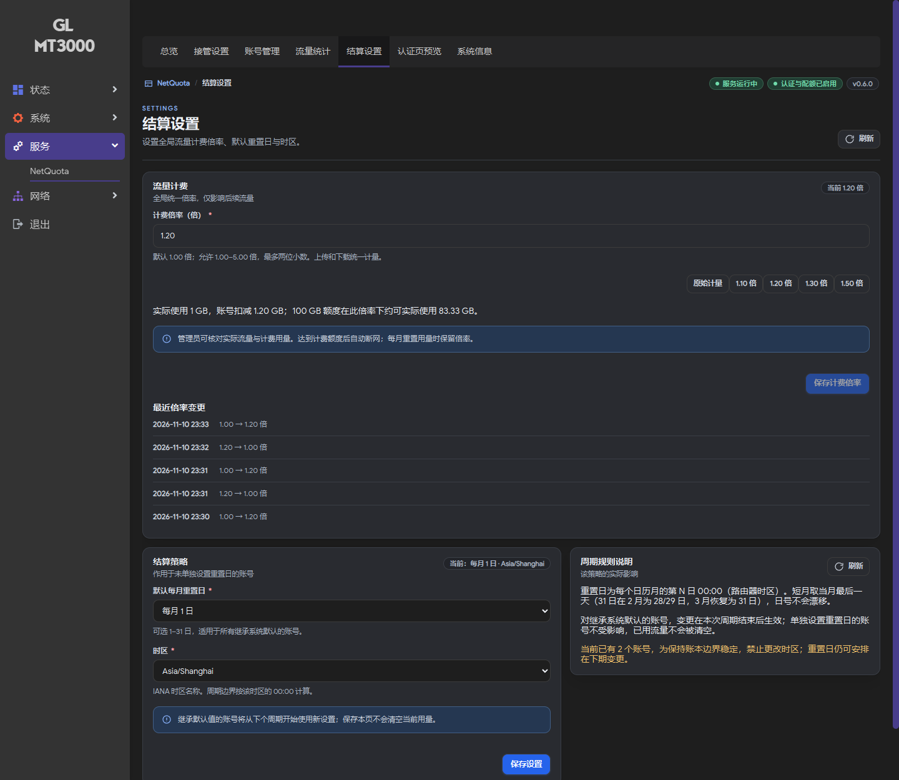
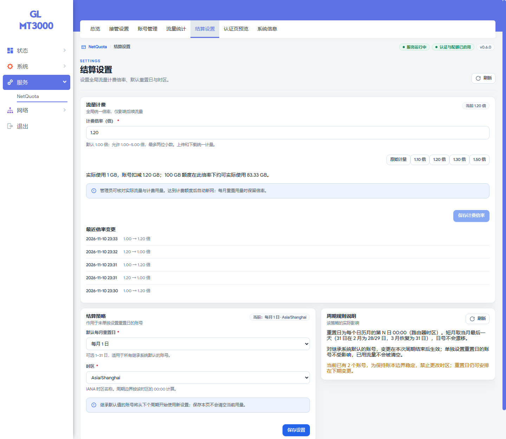

# 0.6.0 全局流量计费倍率验证记录

日期：2026-11-10。设备：GL-MT3000，原厂 OpenWrt 21.02-SNAPSHOT、kernel 5.4.211、opkg/fw3、nftables-nojson 0.9.6。MT6000 与 APK 固件运行仍需单独验收。

## 实现

- 全局倍率 100–500 整数百分比，对应界面的 1.00–5.00 倍；默认 1.00。
- schema v2 增加计费字节、百分之一字节余数与持久化倍率变更记录。原始上传、下载与内核计数保持真实字节口径。
- 升级按原始有效高水位初始化计费量，不清零历史。切换倍率先在守卫下结清旧计数，后续新增计数使用新倍率。
- 剩余计费额度换算为内核真实字节阈值，所有终端与双向流量共享同一额度。门户及管理页按计费用量显示剩余额度，保留实际流量供核对。

## 已执行

- 40 项 Python 测试通过；Windows 缺少 POSIX shell 的三项 hook 测试按既有条件跳过。
- 全部项目 JavaScript 语法检查与 `git diff --check` 通过。
- MT3000 上运行源码 Lua 套件：633 项 domain 检查通过，规则生成/解析、HTTP/HTTPS 门户与部署套件通过。
- 覆盖默认值、仅后续生效、重复/倒退计数、整数溢出、余数跨进程保留、倍率回调不退款、额度调整、周期重置、持久化变更历史、失败后按旧倍率结算、v1 数据迁移。
- 独立三终端网络通过真实 ICMP 数据包验证：1.50 倍时实际 4,112 字节计费 6,168 字节；12,336 字节额度映射为 8,224 字节内核预算；两个终端在轮询前被内核阻断，另一账号仍可转发。倍率降低不恢复耗尽账号，增大额度后重新登录可恢复。测试表与临时网络已清理。
- HTTP/HTTPS 真实处理器验证：上传 400、下载 600 字节，门户实际合计 1,000，计费与已用 1,500，剩余额度按计费量扣减。
- 升级前保存本机备份；停止服务后再次备份。正式账本迁移前后逐项核对全部账号、额度、重置计划、周期 ID、原始计数；所有原有计费用量按 1.00 倍初始化。升级后服务 ready，无错误。
- 实机 LuCI 验证保存、取消、四组非法输入、账户状态不变、持久化记录、亮暗主题、390px 手机布局和实际/计费统计列；七个页面冒烟检查通过，无页面异常。浏览器测试恢复全局倍率至 1.00。
- 提交前两个 0.6.0 IPK 本地构建完成；IPK/APK 的远程构建和 Release 产物由 GitHub Actions 生成。未在 APK 固件上安装验证。

## 界面证据

截图为实机临时设置 1.20 倍时拍摄，测试结束已恢复为 1.00 倍。

## 限制

倍率为人工余量策略，不读取上游账单，不包含绕过受控账号的流量，也不是整船出口总额度。保持既有硬件/软件加速关闭要求与落盘间隔限制；未新增 MT6000、满速吞吐、整机断电或长期稳定性验证。

schema v2 不可直接由旧版后端读取。降级时应恢复升级前备份，避免混用新旧版本。
